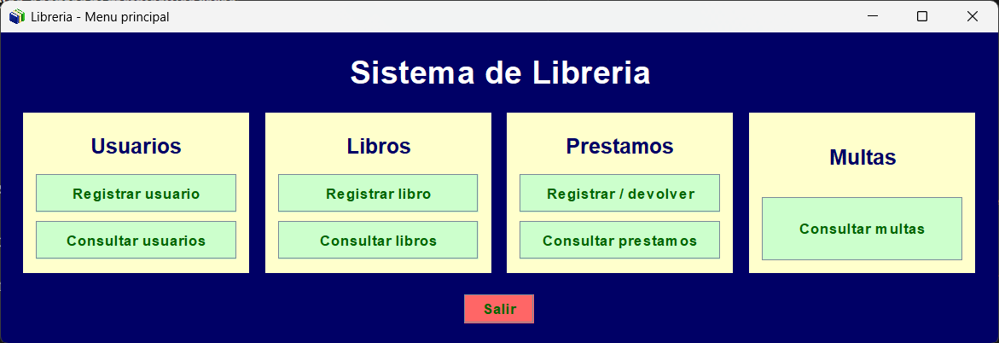
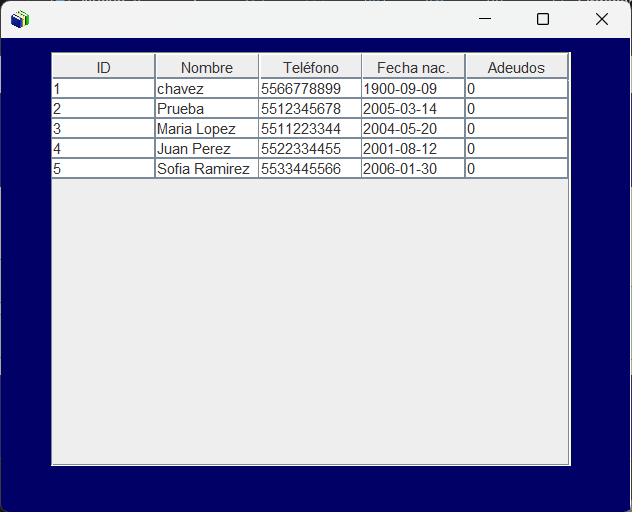
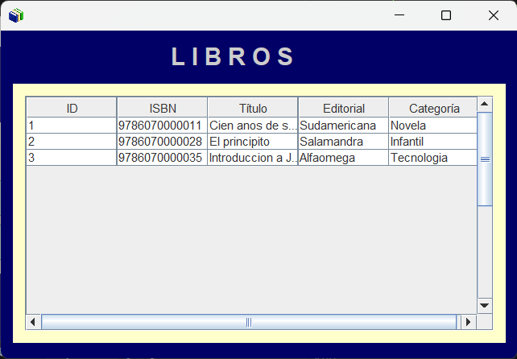
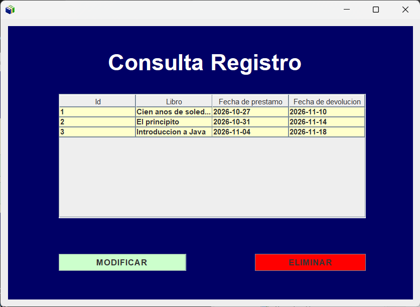
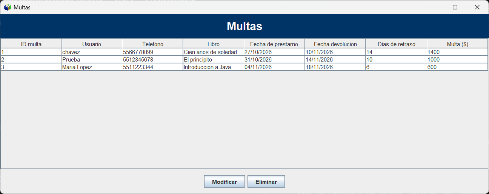

# BiblioTech Desktop

Sistema de escritorio para administrar una librería: usuarios, libros, préstamos y multas.
Proyecto integrador desarrollado en Java con arquitectura por capas (modelo, vista, controlador) y base de datos PostgreSQL.

## Módulos

| Módulo | Funciones |
|---|---|
| **Usuarios** | Registrar, consultar, modificar y eliminar usuarios |
| **Libros** | Registrar, consultar, modificar y eliminar libros (valida que el ISBN no se repita) |
| **Préstamos** | Registrar préstamos, consultar, modificar, eliminar y devolver libros |
| **Multas** | Se generan automáticamente por libros no devueltos a tiempo ($100 por día de retraso); se puede modificar o eliminar el monto |

Todo se abre desde un **menú principal** (`Menu_Principal`).

## Tecnologías

- Java 17
- Java Swing (interfaz gráfica)
- JDBC con el driver de PostgreSQL
- PostgreSQL
- NetBeans + Ant

## Requisitos

- [Java 17](https://adoptium.net/) o superior
- [PostgreSQL](https://www.postgresql.org/download/) (el script fue generado con la versión 17)

## Instalación y uso

### 1. Crear la base de datos

1. Abre pgAdmin y crea una base de datos llamada **`db_libreria`**.
2. Abre el *Query Tool* sobre esa base y ejecuta el script `database/db_libreria.sql`.

> Si usas una versión de PostgreSQL anterior a la 17 y el script marca error, comenta la línea `SET transaction_timeout = 0;`.

### 2. Ejecutar el programa

1. Descarga **`BiblioTech.jar`** desde la sección [Releases](../../releases).
2. Con PostgreSQL encendido, haz doble clic en el JAR o ejecuta:

```
java -jar BiblioTech.jar
```

### Conexión a la base de datos

La conexión está definida en `src/controlador/Conexion.java`:

- Servidor: `localhost:5432`
- Base de datos: `db_libreria`
- Usuario: `postgres`
- Contraseña: la que aparece en `Conexion.java`

Si tu contraseña de PostgreSQL es distinta, cámbiala en ese archivo y vuelve a compilar el proyecto.

## Compilar desde el código fuente

1. Abre el proyecto en NetBeans.
2. Verifica que el driver de PostgreSQL esté agregado en *Properties → Libraries*.
3. En *Properties → Run*, la clase principal debe ser `vista.Menu_Principal`.
4. Clic derecho en el proyecto → **Clean and Build**.
5. Para generar un solo JAR con todo incluido: en la pestaña *Files*, clic derecho en `build.xml` → *Run Target* → *Other Targets* → **package-for-store**. El resultado queda en la carpeta `store/`.

## Estructura del proyecto

```
src/
├── modelo/        Clases que representan los datos
│   ├── Usuario.java
│   ├── ClaseLibro.java
│   ├── ClasePrestamos.java
│   └── ClaseMulta.java
├── controlador/   Conexión y operaciones con la base de datos
│   ├── Conexion.java
│   ├── Crud.java            (usuarios)
│   ├── Crud_Libros.java
│   ├── Crud_Prestamo.java
│   └── Crud_Multas.java
├── vista/         Ventanas de la aplicación
│   ├── Menu_Principal.java
│   ├── Registro_Usuarios.java / Consulta_Usuarios.java / Editar_Usuario.java
│   ├── Registro_Libros.java / Consulta_Libros.java / Editar_Libro.java
│   ├── Gestion_Prestamos.java / Consulta_Prestamo.java / Edicion_Prestamo.java
│   ├── Consulta_Multas.java
│   └── Iconos.java
└── mvc/
    └── icono.png
```

## Base de datos

Tablas principales: `usuario`, `libro`, `pide` (préstamos), `multa`, `admin`, `registra_u` y `registra_l`.

Las llaves foráneas usan `ON DELETE CASCADE`: al eliminar un usuario o un libro también se eliminan sus préstamos y multas.

## Capturas de pantalla

### Menú principal


### Usuarios


### Libros


### Préstamos


### Multas


## Proyecto por: 

**Christopher Barrios**.\
**Raul Chavez**.\
**Christopher Pedraza**.\
Proyecto escolar de programación.
